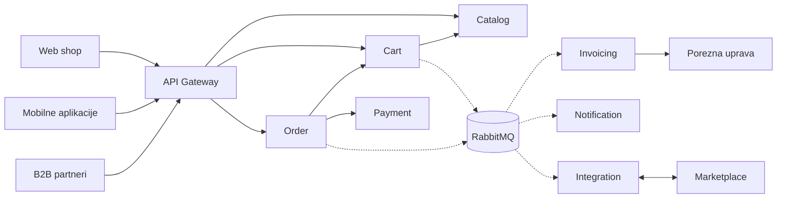
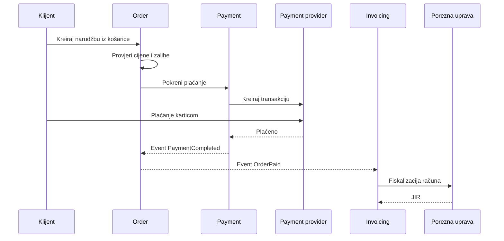
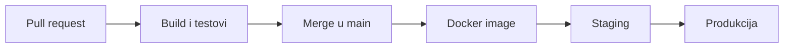

# Arhitektura online maloprodajne platforme

Dokument opisuje high-level dizajn platforme i plan kako je izgraditi.

## Sadržaj

1. [Arhitekturalni pogled](#1-arhitekturalni-pogled)
2. [Strategija skaliranja](#2-strategija-skaliranja)
3. [Sigurnost i autentifikacija](#3-sigurnost-i-autentifikacija)
4. [Ključne komponente i odgovornosti](#4-ključne-komponente-i-odgovornosti)
5. [Integracija s vanjskim servisima](#5-integracija-s-vanjskim-servisima)
6. [Monitoring i alerting](#6-monitoring-i-alerting)
7. [Plan isporuke koda](#7-plan-isporuke-koda)

## 1. Arhitekturalni pogled

Platforma je podijeljena na manje servise. Svaki servis pokriva jedan dio posla i ima svoju bazu. Tako se svaki može razvijati i skalirati zasebno.

Svi prodajni kanali koriste iste servise. Ulaze kroz jedan API Gateway.

Puna linija je direktan poziv preko REST-a. Isprekidana linija je event preko RabbitMQ-a.

Kako servisi komuniciraju:

- REST se koristi kad korisnik čeka odgovor. Na primjer kod dodavanja u košaricu ili kreiranja narudžbe.
- Eventi se koriste za sve što se može napraviti kasnije. Na primjer fiskalizacija, emailovi i slanje podataka marketplaceima.
- Eventi se prvo spremaju u bazu zajedno s promjenom, a tek onda šalju. To se zove outbox pattern. Zato se event ne može izgubiti.
- Isti event ponekad može stići dvaput. Servis koji ga prima zato pamti koje je poruke već obradio.

Real-time obrada znači da se svaka promjena odmah objavi kao event. Ostali servisi je obrade u par sekundi.

Glavne tehnologije:

| Područje | Tehnologija |
|---|---|
| Servisi | .NET 10, ASP.NET Core Web API |
| Baza | PostgreSQL, posebna za svaki servis |
| Cache | Redis |
| Poruke | RabbitMQ |
| Logovi | Serilog, Elasticsearch, Kibana |
| Pokretanje | Docker |
| CI | GitHub Actions |

## 2. Strategija skaliranja

- Servisi ne drže ništa u memoriji. Korisnik se čita iz tokena, a podaci su u bazi i Redisu. Zato se pod većim prometom samo doda još instanci iza load balancera.
- Podaci koji se često čitaju drže se u Redisu. Kod svake promjene briše se stari zapis iz cachea.
- Baza ima indekse za upite koji se najčešće koriste. Katalog se može čitati s read replika.
- Sporiji poslovi idu preko RabbitMQ-a. Kad dođe puno zahtjeva odjednom, poruke čekaju u redu i obrade se redom.
- Rate limiting štiti servise od previše zahtjeva. Svaki poziv prema drugom servisu ima timeout.
- Kod istovremenih izmjena ne zaključavamo podatke. Svaka košarica ima verziju. Ako ju je netko u međuvremenu promijenio, zahtjev vraća grešku 409 i klijent pokuša ponovno.

## 3. Sigurnost i autentifikacija

- Korisnik se prijavi kod identity providera preko OpenID Connecta. Dobije JWT token koji kratko traje. Servisi samo provjere je li token ispravan.
- B2B partneri nisu ljudi nego sustavi. Dobiju vlastite pristupne podatke i sami dohvaćaju token (OAuth 2.0 client credentials). Svaki partner ima svoj limit zahtjeva.
- ID korisnika uvijek se uzima iz tokena, nikad iz URL-a. Zato nitko ne može vidjeti tuđu košaricu ili narudžbu.
- Podaci o kartici nikad ne prolaze kroz naš sustav. Kupac plaća direktno kod payment providera. Mi spremamo samo broj transakcije.
- Cijenu nikad ne šalje klijent. Uzima se iz kataloga. Kod checkouta se cijene i zalihe još jednom provjere.
- Sva komunikacija ide preko HTTPS-a. Osobni podaci ne pišu se u logove. Lozinke i certifikati nisu u kodu.

## 4. Ključne komponente i odgovornosti

| Komponenta | Odgovornost | Tim |
|---|---|---|
| API Gateway | Usmjeravanje zahtjeva, provjera tokena, limiti | Zajedničko |
| Catalog | Proizvodi, cijene i zalihe | Tim 1 |
| Cart | Košarica korisnika | Tim 1 |
| Notification | Emailovi i push obavijesti | Tim 1 |
| Order | Narudžba i checkout | Tim 2 |
| Payment | Plaćanje preko payment providera | Tim 2 |
| Invoicing | Računi i fiskalizacija | Tim 2 |
| Integration | Marketplace i B2B partneri | Tim 2 |

Tim 1 radi sve do narudžbe, dakle proizvode i košaricu. Tim 2 radi sve od narudžbe nadalje.

Svaki tim sam razvija i isporučuje svoje servise. Timovi ne dijele bazu. Komuniciraju samo preko API-ja i evenata.

## 5. Integracija s vanjskim servisima

Checkout tok:

Fiskalizacija:

- Fiskalizaciju radi Invoicing servis nakon što je narudžba plaćena. Kupac ne čeka Poreznu upravu.
- Invoicing napravi račun i pošalje ga Poreznoj upravi, potpisan FINA certifikatom. Porezna vrati JIR, koji se spremi uz račun.
- Ako Porezna uprava ne odgovara, račun se pošalje ponovno kasnije. Svaki račun ima svoj broj, pa se ne može fiskalizirati dvaput.
- B2B kupci dobivaju eRačun, prema pravilima Fiskalizacije 2.0.

Ostale integracije:

- Payment provider: kupac plaća na njihovoj stranici. Oni nam javljaju je li plaćanje uspjelo.
- Marketplace: šaljemo im proizvode i zalihe. Njihove narudžbe ulaze kroz naš Order servis.
- B2B partneri: koriste isti API kao ostali kanali.
- Svaki poziv prema vanjskom sustavu ima timeout i ponovni pokušaj. Ako vanjski sustav ne radi, naš servis i dalje radi.

## 6. Monitoring i alerting

Health checkovi (implementirano u Cart servisu):

- `/health/live` provjerava radi li aplikacija. Ako ne odgovara, instanca se restarta.
- `/health/ready` provjerava rade li baza, Redis i RabbitMQ. Ako ne rade, instanca privremeno ne prima promet.

Logovi (implementirano u Cart servisu):

- Logovi se šalju u Elasticsearch i pretražuju u Kibani.
- Svaki zahtjev ima svoj `X-Correlation-ID`. Isti ID ide i u evente. Tako se jedan zahtjev može pratiti kroz sve servise.

Alarmi:

- puno grešaka ili spori odgovori
- health check ne prolazi
- eventi se ne šalju iz outboxa
- red poruka u RabbitMQ-u raste
- fiskalizacija kasni

## 7. Plan isporuke koda

Branching (GitHub Flow):

- `main` je uvijek spreman za isporuku.
- Svaka promjena radi se na kratkoj feature grani.
- U `main` ulazi kroz pull request, nakon code reviewa i uspješnog CI-ja.
- Ovaj repozitorij je napravljen na isti način. Svaki dio je imao svoju granu i svoj PR.

CI/CD:

- CI (implementirano): GitHub Actions na svaki PR napravi build i pokrene sve testove. Integracijski testovi koriste pravi PostgreSQL, Redis i RabbitMQ u Dockeru.
- CD (samo dizajn): nakon mergea se napravi Docker image. Prvo ide na staging, a nakon provjere u produkciju.
- Migracije baze pokreću se kao poseban korak prije deploya. Ne pokreću se kad se aplikacija pali, jer bi više instanci odjednom pokušalo mijenjati istu bazu.
